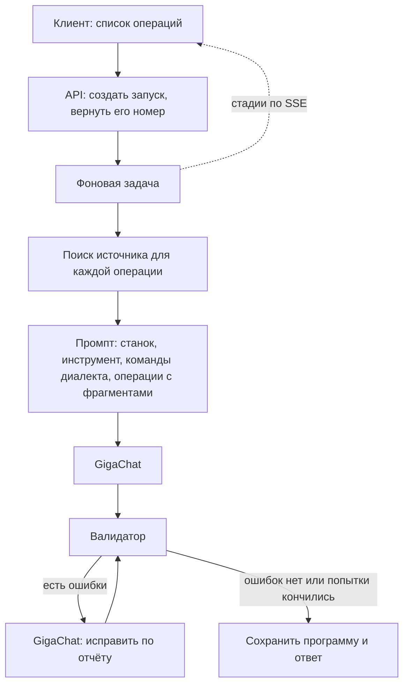

# Руководство по проекту

Прототип помощника технолога: по списку операций собирает управляющую программу (УП) для токарного станка с ЧПУ, опираясь на похожие операции из базы знаний. Запуск описан в [README](../README.md), план работ — в [PLAN](PLAN.md).

## 1. Идея за одну минуту

Обычная языковая модель пишет G-код «по памяти» и часто ошибается. Здесь используется RAG (генерация с опорой на поиск):

1. Технолог перечисляет операции: «подрезать торец», «просверлить отверстие».
2. Для каждой операции система ищет похожую в базе знаний — среди проверенных программ, разбитых на операции.
3. Найденные фрагменты G-кода передаются модели GigaChat как образец.
4. Модель собирает из них программу под конкретный станок.
5. Валидатор проверяет результат; если есть ошибки, модель исправляет их по отчёту.

Ключевая мысль: модель не выдумывает программу, а адаптирует найденные примеры.

## 2. Как пользоваться

Откройте http://localhost:5173.

1. **Слева** выберите станок и материал, нажмите «Начать новый чат». Станок определяет диалект G-кода.
2. **В центре** заполните операции: тип из списка и описание. Чем конкретнее описание (диаметры, длины, номер инструмента, режимы), тем лучше результат.
3. Нажмите «Сгенерировать программу». Пока идёт работа, показываются стадия и таймер.
4. **Справа** появится программа, отчёт валидатора и источники по каждой операции.
5. Текст программы можно править. «Сохранить изменения» создаёт новую версию и заново проверяет её.
6. Чтобы изменить уже готовую программу, в форме запроса переключитесь на «Изменить текущую программу», опишите изменение («глубину сверления сделать 35 мм») и при необходимости добавьте новые операции. Модель получает текущий текст программы, включая ваши ручные правки, и возвращает изменённую версию той же программы. Если в редакторе есть несохранённые правки, они сохраняются отдельной версией перед запросом. Под редактором можно развернуть блок «Изменения относительно предыдущей версии».

### Зачем указывать материал

Режимы резания (скорость, подача, глубина) зависят от материала заготовки: алюминий точат на скорости около 250 м/мин, нержавеющую сталь — на 80–100 м/мин. Программа для стали на алюминии будет работать неэффективно, а на нержавейке может сломать инструмент. Поэтому материал используется в двух местах:

1. В запрос к модели добавляются рекомендуемые режимы резания для этого материала и типов операций запроса (справочник `CUTTING_MODES` в `backend/app/kb/refs.py`). Они применяются, только если режима нет в описании операции. Значения ориентировочные и должны быть проверены специалистом.
2. При поиске сначала ищется образец на том же материале, затем без этого условия.

### Что означают источники

| Источник | Что произошло |
|---|---|
| из базы знаний | Нашлась похожая операция на диалекте этого станка |
| источника нет | Похожей операции нет, либо она есть только на другом диалекте. Модель пишет операцию сама — доверия к ней меньше |
| конвертирована | Зарезервировано под конвертер диалектов; сейчас он не реализован, поэтому такой источник не появляется |

Число «расстояние» показывает, насколько найденная операция похожа на запрос: 0 — совпадает, 1 — ничего общего. Операции с расстоянием больше порога (`SEARCH_MAX_DISTANCE`, по умолчанию 0,5) считаются нерелевантными.

Метка программы — худший из источников её операций.

## 3. Примеры запросов

В базе знаний сейчас четыре программы:

| Программа | Станок | Материал | Операции |
|---|---|---|---|
| Вал ступенчатый с резьбой | Fanuc | сталь | подрезка торца, точение (G71), резьба (G76) |
| Втулка с центральным отверстием | Fanuc | сталь | подрезка торца, сверление (G83) |
| Втулка с наружным контуром | Sinumerik | сталь | подрезка торца, точение (CYCLE95), сверление (CYCLE82) |
| Вал гладкий алюминиевый | Sinumerik | алюминий | подрезка торца, точение простыми проходами |

Примеры ниже подобраны под эти данные и показывают разные ветки поиска.

### Пример 1. Всё находится в базе

Станок Fanuc, конструкционная сталь.

| Тип | Описание |
|---|---|
| Подрезка торца | Подрезка торца заготовки диаметром 60 мм проходным резцом T0101, скорость резания 120 м/мин, подача 0.15 мм/об |
| Сверление | Сверление центрального отверстия диаметром 20 мм на глубину 30 мм сверлом T1111, цикл глубокого сверления |

Ожидается: обе операции «из базы знаний», источник — «Втулка с центральным отверстием», расстояния около 0,12 и 0,21.

### Пример 2. Операция есть только на другом диалекте

Станок Sinumerik, конструкционная сталь.

| Тип | Описание |
|---|---|
| Подрезка торца | Подрезка торца заготовки диаметром 60 мм проходным резцом T1, скорость резания 110 м/мин, подача 0.15 мм/об |
| Нарезание резьбы | Нарезание наружной метрической резьбы М30х1.5 длиной 20 мм резьбовым резцом T3, 700 об/мин |
| Сверление | Сверление центрального отверстия диаметром 20 мм на глубину 25 мм сверлом T5, 400 об/мин |

Ожидается: торец и сверление «из базы знаний»; резьба — «источника нет» с пояснением, что похожая операция найдена на Fanuc, но перевести её нельзя.

### Пример 3. Ослабление фильтра по материалу

Станок Fanuc, алюминиевый сплав.

| Тип | Описание |
|---|---|
| Подрезка торца | Подрезка торца алюминиевой заготовки диаметром 50 мм резцом T0101, скорость резания 250 м/мин |

Ожидается: «из базы знаний», хотя программ для алюминия на Fanuc нет. Система сначала ищет с тем же материалом, не находит и повторяет поиск без учёта материала.

### Пример 4. Ничего похожего нет

Станок Fanuc, конструкционная сталь.

| Тип | Описание |
|---|---|
| Наружное точение | Проточить галтель радиусом 3 мм фасонным резцом T0202 |

Ожидается: «источника нет», пояснение «В базе знаний нет похожих операций». Ближайшая операция находится на расстоянии около 0,75 — дальше порога.

### Пример 5. Работа валидатора

Сгенерируйте любую программу, затем в поле текста замените номер инструмента на несуществующий (для Fanuc — `T0909`), поставьте `G97 S9000 M3` и удалите последнюю строку с `M30`. После сохранения отчёт покажет три ошибки с номерами строк. Правка при этом сохраняется: решение остаётся за технологом.

### Чего ждать от качества

Пайплайн работает, но базовая модель GigaChat ведёт себя нестабильно: один и тот же запрос даёт разные программы.

- Размеры из запроса модель подставляет не всегда. В проверочных прогонах глубина сверления и диаметр торца то брались из запроса, то оставались из найденного примера.
- Операцию без источника модель пишет по подсказке диалекта (`op_hints` в описании диалекта) и склонна переносить пример из подсказки дословно, вместе с его числами.
- Иногда модель пропускает вызов инструмента или режимы для операции.
- Комментарии из ответа модели вырезаются: модель упорно пишет их в чужом синтаксисе.
- Валидатор проверяет форму, а не смысл: «Замечаний нет» не значит, что программа верна.
- Числа из описания операций (диаметры, глубины, скорость, подача, инструмент) проверяются отдельно: если значения нет в программе, в отчёте появится предупреждение без номера строки. Это предупреждение, а не ошибка: оно не запускает доработку, решение остаётся за технологом.

Вывод для пользователя: сверяйте числа в программе с запросом.

## 4. Как устроено внутри

### Путь запроса



Генерация занимает десятки секунд, поэтому идёт в фоне. Клиент сразу получает номер запуска и подписывается на его события; сервер присылает стадию при каждой смене. Состояние запуска хранится в базе, так что обновление страницы результат не теряет.

### Поиск источника

Для каждой операции делается до четырёх попыток, от строгой к мягкой:

1. тот же диалект и тот же материал;
2. тот же диалект, любой материал;
3. другой диалект и тот же материал;
4. другой диалект, любой материал.

Первые две дают источник «из базы знаний». Третья и четвёртая ведут в конвертер; он сейчас заглушка, поэтому операция получает «источника нет».

Внутри каждой попытки: отбор по типу станка, типу операции и статусу «подтверждена», затем сортировка по расстоянию между вектором запроса и векторами операций.

### Откуда берутся векторы

Вектор (эмбеддинг) — это список из 1024 чисел, описывающий текст. Сейчас он строится простой функцией: текст режется на слова, каждое слово увеличивает одну из ячеек. Два текста близки, если в них много общих слов. Синонимы так не находятся.

Смысловые векторы даёт нейросетевая модель. У GigaChat это отдельный платный пакет; код под него готов и включается переменной `EMBEDDING_PROVIDER=gigachat` с последующей перезагрузкой базы знаний.

### Модули бэкенда

Всё лежит в `backend/app`.

| Папка | Назначение | С чего начать читать |
|---|---|---|
| `nc/` | Работа с G-кодом: описания диалектов, разбор текста, валидатор, заглушка конвертера. Не зависит от базы и веб-сервера | `validator.py`, `dialects/fanuc_turn.yaml` |
| `llm/` | Обращение к моделям. Общий интерфейс, адаптер GigaChat и заглушки для работы без сети | `base.py`, затем `gigachat.py` |
| `kb/` | База знаний: таблицы станков, программ и операций, загрузка и поиск | `search.py` |
| `orchestrator/` | Пайплайн генерации и фоновые запуски, шаблоны промптов | `pipeline.py`, `prompts/generate.md` |
| `chat/` | Чаты, сообщения, версии программ и HTTP-эндпоинты | `api.py` |

Точка входа — `main.py`. Настройки читаются из `.env` в `config.py`.

Модули связаны через три функции, которые можно заменить, не трогая остальное:

- `nc.validate(text, dialect, machine)` — отчёт об ошибках;
- `nc.convert(text, src, dst)` — перевод между диалектами;
- интерфейсы `ChatModel.complete` и `EmbeddingModel.embed` — любая модель.

### Таблицы

| Таблица | Что хранит |
|---|---|
| `machines` | Станок: диалект, предел оборотов, инструмент по позициям |
| `programs` | Программа: текст, станок, материал, статус, происхождение |
| `operations` | Операция внутри программы: тип, строки, описание, вектор |
| `chats`, `messages` | Чат и история запросов и ответов |
| `program_versions` | Версии программы с отчётами валидатора |
| `generation_runs` | Запуски генерации и их стадии |

Программы базы знаний и сгенерированные программы лежат в одной таблице. В поиск попадают только со статусом `confirmed`; сгенерированные получают `generated`.

### Клиент

`frontend/src`: `api.ts` — запросы к серверу, `store.ts` — состояние и подписка на события запуска, `App.vue` и два компонента — экран. Интерфейс собран из компонентов Naive UI.

## 5. Как расширять

**Добавить программу в базу знаний.** Создайте файл в `backend/seed/programs/` по образцу соседних: шапка, операции с типом, описанием и кодом, концовка. Затем:

```bash
docker compose exec backend python -m seed.seed
```

Скрипт проверит программу валидатором и напечатает замечания. Описание операции — то, по чему её будут искать, поэтому пишите его так, как технолог сформулировал бы запрос.

**Добавить станок.** Допишите запись в `backend/seed/data/machines.yaml` и запустите тот же скрипт.

**Добавить команду в диалект.** Допишите её в `backend/app/nc/dialects/<диалект>.yaml`. После перезапуска бэкенда (`docker compose restart backend`) валидатор начнёт её принимать, а модель увидит её в списке допустимых.

**Изменить поведение модели.** Правьте шаблоны в `backend/app/orchestrator/prompts/` — перезапуск не нужен. Подсказки о том, каким циклом выполняется операция, лежат в описании диалекта в разделе `op_hints`; после их правки перезапустите бэкенд.

**Поменять настройки.** Порог расстояния, число попыток исправления, таймауты и модель задаются в `.env`; после правки перезапустите бэкенд:

```bash
docker compose up -d
```

## 6. Ограничения прототипа

- Только токарная обработка, два диалекта, два станка.
- Поиск по совпадению слов, а не по смыслу.
- Конвертера диалектов нет.
- Валидатор проверяет пять вещей: синтаксис, известность команд, конец программы, наличие инструмента в магазине, предел оборотов.
- Один пользователь, входа нет.
- Документация станков в базу знаний не загружается: модель получает список команд диалекта и короткие подсказки по каждому типу операции.
- Программы не проверяются симуляцией и не предназначены для запуска на станке.
