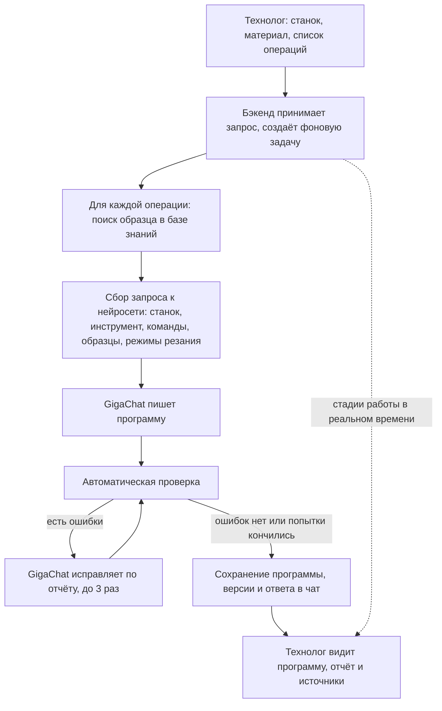
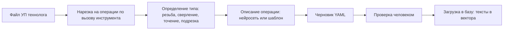

# Как работает система: простыми словами

Документ для тех, кто не программист и не технолог. Он объясняет, что делает система, откуда берутся данные и какой путь проходит запрос от слов технолога до готовой программы для станка. Технические детали — в [INTERNALS](INTERNALS.md), инструкция по использованию — в [GUIDE](GUIDE.md).

## 1. Что это за система

Токарный станок с ЧПУ выполняет **управляющую программу** (УП) — текстовый файл из строк вроде `G1 X20 Z-30 F0.15` («двигай резец по прямой до такого-то места с такой-то подачей»). Писать такие программы вручную долго, а у разных станков разный «язык» команд (диалект): Fanuc и Sinumerik пишут одно и то же по-разному.

Система помогает технологу:

1. Технолог **перечисляет операции словами**: «подрезать торец заготовки диаметром 60 мм резцом T0101», «просверлить отверстие диаметром 20 мм на глубину 30 мм».
2. Система **находит в своей базе похожие уже проверенные операции** и берёт их код как образец.
3. Нейросеть (GigaChat) **собирает из образцов программу** под конкретный станок и конкретные размеры.
4. Программа **автоматически проверяется**; если есть ошибки, нейросеть их исправляет.
5. Технолог получает результат, **правит его и просит изменить** («сделай подачу 0.2»).

Главная идея: нейросеть не придумывает программу «из головы», а переделывает проверенные образцы. Такой подход называется RAG (генерация с поиском по базе знаний).

> Программа не проверена на станке и не подтверждена технологом. Перед запуском её обязательно смотрит человек.

## 2. Из каких частей состоит система

| Часть | Что делает | Где живёт |
|---|---|---|
| **Интерфейс** | Страница в браузере: чаты, форма операций, показ программы | `frontend/`, открывается на `localhost:5173` |
| **Бэкенд** | Главный «мозг»: принимает запросы, ищет образцы, общается с нейросетью, проверяет программу | `backend/`, контейнер `backend` |
| **База данных** | Хранит станки, программы-образцы, чаты, результаты. Умеет искать «похожее» по смыслу | PostgreSQL с расширением pgvector, контейнер `db` |
| **Сервис эмбеддингов** | Превращает текст в набор чисел, по которому можно сравнивать смысл (модель bge-m3) | контейнер `embeddings` |
| **Реранкер** | Второй, более внимательный отбор лучших образцов (модель bge-reranker-v2-m3) | контейнер `reranker` |
| **GigaChat** | Нейросеть, которая пишет и правит программу | внешний сервис Сбера, по интернету |

Сервис эмбеддингов и реранкер необязательные: без них система работает на упрощённой заглушке (поиск по совпадению слов).

## 3. Какие данные где хранятся

### В базе данных

| Что | Что это такое |
|---|---|
| **Станки** | Название, диалект, предельные обороты, список инструмента в револьверной головке |
| **Программы-образцы** | Целая УП с метаданными: станок, диалект, материал, статус «подтверждена» |
| **Операции** | Куски образцов: какие строки программы относятся к какой операции, текстовое описание и «числовой отпечаток смысла» (вектор) |
| **Чаты** | Диалог технолога: станок и материал, сообщения |
| **Сообщения** | Запрос технолога (список операций или инструкция) и ответ системы |
| **Программы чата и их версии** | Каждая сгенерированная программа и все её версии: сгенерирована, исправлена вручную, изменена по запросу |
| **Запуски генерации** | В какой стадии работа (поиск, генерация, проверка…), ошибки, время |

### В файлах проекта

| Что | Где | Зачем |
|---|---|---|
| **Описание диалектов** | `backend/app/nc/dialects/*.yaml` | Список допустимых команд, как вызывается инструмент, как завершается программа, подсказки «чем в этом диалекте делается сверление» |
| **Образцы УП** | `backend/seed/programs/*.yaml` | Исходные программы с разметкой операций; загружаются в базу командой `seed` |
| **Станки** | `backend/seed/data/machines.yaml` | Список станков для первичной загрузки |
| **Тексты запросов к нейросети** | `backend/app/orchestrator/prompts/*.md` | Шаблоны: «ты технолог…», «исправь ошибки…», «измени программу…» |
| **Справочники** | `backend/app/kb/refs.py` | Типы операций, материалы, ориентировочные режимы резания по материалам |
| **Запросы для оценки** | `backend/eval/*.yaml` | Набор проверочных запросов, чтобы измерять качество |

## 4. Путь запроса: от слов до программы

Пример: технолог выбрал станок Fanuc и сталь, ввёл две операции — подрезку торца и сверление — и нажал «Сгенерировать программу».

### Шаг 0. Запрос принят

Бэкенд сохраняет запрос технолога в базу и сразу отвечает «принято», не дожидаясь результата: генерация занимает 15–40 секунд. Работа идёт в фоне, а интерфейс по живому каналу получает стадии («поиск», «генерация», «проверка»…) и показывает таймер. Если обновить страницу, результат не потеряется: состояние лежит в базе.

### Шаг 1. Поиск образца для каждой операции

Для каждой операции из запроса система отвечает на вопрос: «есть ли в базе проверенная операция, похожая на эту?»

1. **Описание превращается в вектор.** Фраза вида «Подрезка торца. Подрезка торца заготовки диаметром 60 мм…» отправляется в сервис эмбеддингов, который возвращает список из 1024 чисел. Похожие по смыслу фразы дают близкие списки чисел.
2. **Отбор по жёстким признакам.** В базе остаются только подтверждённые программы, того же типа станка и того же типа операции (подрезка с подрезкой, не со сверлением).
3. **Поиск по близости.** Среди оставшихся операций берутся самые близкие по смыслу.
4. **Реранкер** (если включён) читает запрос вместе с каждым кандидатом целиком, включая его код, и ставит оценку 0–1. Остаются кандидаты выше порога.
5. **Порядок поиска «от строгого к мягкому»:**

| Попытка | Что ищем | Результат |
|---|---|---|
| 1 | Тот же диалект, тот же материал | «из базы знаний» |
| 2 | Тот же диалект, любой материал | «из базы знаний» |
| 3–4 | Другой диалект | нужен конвертер, он пока не сделан, поэтому «источника нет» |
| — | Ничего не нашлось | «источника нет» |

Итог шага: для каждой операции известен образец (кусок кода) либо пометка «образца нет».

### Шаг 2. Сбор запроса к нейросети

Бэкенд собирает один большой текст из шаблона и данных:

| Блок | Откуда берётся |
|---|---|
| Кто ты и общие правила | `prompts/system.md` |
| Станок: название, диалект, обороты, инструмент в магазине | карточка станка из базы |
| Материал заготовки | выбор технолога |
| Операции: описание технолога + найденный образец | запрос + шаг 1 |
| «Как это делается в этом диалекте» | подсказки в описании диалекта |
| Рекомендуемые режимы резания для материала | справочник `CUTTING_MODES` |
| Допустимые команды | описание диалекта |

Если образца нет, нейросети дают только подсказку, как операцию выполняет этот диалект.

### Шаг 3. Нейросеть пишет программу

Запрос уходит в GigaChat, обратно приходит текст: короткое пояснение и программа в блоке кода. Бэкенд:

- берёт самый полный блок кода (модель иногда присылает черновик и итог);
- вырезает комментарии, которые модель добавляет вопреки правилам и часто в чужом синтаксисе.

Если программы в ответе нет, запуск заканчивается ошибкой.

### Шаг 4. Автоматическая проверка

Программа разбирается по строкам и проверяется:

| Проверка | Что ловит |
|---|---|
| Синтаксис | Непарные скобки, нераспознанные куски строки |
| Известные команды | Команды, которых нет в диалекте этого станка |
| Конец программы | Нет `M30` и аналогов |
| Инструмент в магазине | Вызван инструмент, которого на станке нет |
| Предел оборотов | Обороты выше возможностей станка (с учётом режима постоянной скорости) |
| **Числа из запроса** | Размер, подача, скорость или инструмент из описания не встречаются в программе (это предупреждение, а не ошибка) |

### Шаг 5. Цикл исправления

Если найдены **ошибки** (предупреждения не считаются), нейросети отправляется программа вместе со списком замечаний с номерами строк: «исправь, остальное не меняй». Так повторяется не более трёх раз. Цикл останавливается раньше, если попытка не уменьшила число ошибок.

### Шаг 6. Сохранение и показ

В базу записываются: программа, её первая версия, пометка источников по каждой операции и ответное сообщение в чате. Интерфейс получает сигнал «готово» и показывает:

- текст программы в редакторе;
- отчёт проверки;
- источники по операциям: из базы знаний (с названием образца и показателем близости), «источника нет» (с пояснением);
- общую метку надёжности: она равна худшему из источников.

## 5. Что происходит при правке программы

Технолог может сам поправить текст, а может попросить систему: «глубину сверления сделать 35 мм» и при желании добавить новые операции.

1. Если в редакторе есть несохранённые правки, они сохраняются отдельной версией.
2. Бэкенд берёт **актуальный текст программы** (со всеми ручными правками) и отправляет нейросети вместе с инструкцией: «измени только это, остальное оставь».
3. Для добавленных операций сначала выполняется поиск образцов, как в шаге 1.
4. Дальше обычная проверка и цикл исправления.
5. Результат сохраняется **новой версией той же программы**, в интерфейсе виден список версий и разница с предыдущей.

## 6. Как данные попадают в базу знаний

Откуда берутся образцы, на которых всё держится:

1. **Нарезка.** Программа делится на операции: новая операция начинается с вызова инструмента. Шапка и концовка отделяются.
2. **Тип операции** определяется по характерным командам (например, `G83` — сверление, `G76` — резьба).
3. **Описание.** Нейросеть пишет для каждой операции короткое описание по коду, либо подставляется шаблон из найденных чисел.
4. **Черновик в файле.** Всё записывается в YAML-файл. **Человек проверяет** границы, типы и описания.
5. **Загрузка.** После проверки команда `seed` помещает программы в базу, а для описаний операций считаются векторы.

В базе знаний есть только то, что человек подтвердил: поиск использует программы со статусом «подтверждена».

## 7. Что уходит наружу

| Что | Куда | Когда |
|---|---|---|
| Запрос к нейросети: станок, инструмент, описания операций, **код образцов из базы**, текущая программа при правке | GigaChat (Сбер), по интернету | При каждой генерации, исправлении и правке |
| Тексты операций для векторов | Локальный контейнер `embeddings` | Если `EMBEDDING_PROVIDER=tei`: ничего наружу не уходит |
| Те же тексты | GigaChat Embeddings | Если `EMBEDDING_PROVIDER=gigachat` |
| Всё остальное (чаты, программы, версии) | Только в вашу базу данных | — |

Ключ доступа к GigaChat хранится в файле `.env`, в репозиторий он не попадает.

## 8. Режимы работы

| Настройка | Значения | Что меняет |
|---|---|---|
| `LLM_PROVIDER` | `mock` / `gigachat` | Заглушка (собирает программу из образцов без нейросети) или живой GigaChat |
| `EMBEDDING_PROVIDER` | `mock` / `tei` / `gigachat` | Поиск по совпадению слов, по смыслу локальной моделью или по смыслу через GigaChat |
| `RERANKER_PROVIDER` | `none` / `tei` | Без второго отбора или с ним |

После смены `EMBEDDING_PROVIDER` базу знаний нужно загрузить заново, иначе векторы в базе и в запросах будут из разных «систем координат».

## 9. Что система пока не умеет

- **Конвертировать** операцию из одного диалекта в другой: если образец есть только на другом станке, считается, что источника нет.
- **Фрезерная обработка:** только токарная.
- **Проверять смысл программы:** проверяется форма и согласие с запросом, но не геометрия и не столкновения. Для этого нужна симуляция.
- **Учиться на подтверждённых результатах:** подтверждение технологом и возврат сгенерированных программ в базу знаний пока не реализованы.
- **Разграничивать пользователей:** вход и роли не сделаны, система работает от одного предустановленного пользователя.

## 10. Словарь

| Термин | Значение |
|---|---|
| УП | Управляющая программа — текст команд для станка |
| G-код | Язык команд станка ЧПУ |
| Диалект | Вариант G-кода конкретной системы управления (Fanuc, Sinumerik) |
| Операция | Законченный этап обработки: подрезка торца, сверление, нарезание резьбы |
| База знаний | Проверенные программы, разбитые на операции |
| RAG | Подход: сначала найти нужное в базе, потом попросить нейросеть сформулировать ответ по найденному |
| Эмбеддинг, вектор | Список чисел, описывающий смысл текста; близкие тексты дают близкие списки |
| Реранкер | Модель, которая внимательнее оценивает пары «запрос — кандидат» и выбирает лучшие |
| Образец | Найденная операция, по которой нейросеть пишет новую |
| Валидатор | Автоматическая проверка программы |
| Версия | Состояние программы после генерации, ручной правки или правки по запросу |
